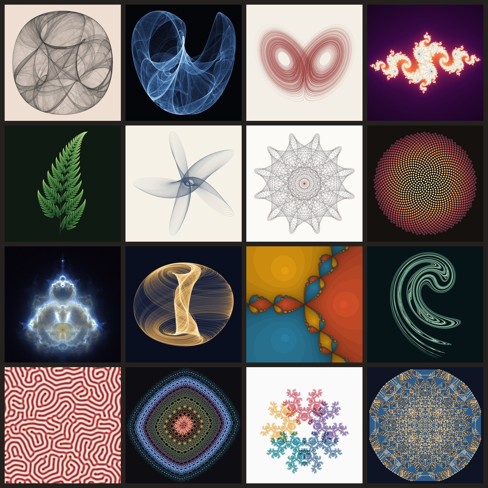

# Math Art Gallery

**View the gallery: https://jq6l43d1.github.io/math-art-gallery/**



Every image here is generated from an equation. I got hooked after seeing a
Clifford attractor plotted from 10 million points, which took an hour to
render in LaTeX, and wanted to see how far plain Python could get. With numpy
the same 10 million points take about two seconds, so I kept adding pieces.

| No. | Piece | The math |
| --- | --- | --- |
| 1 | [Clifford attractor](gallery/pieces/clifford.py) | `x' = sin(a y) + c cos(a x)`, `y' = sin(b x) + d cos(b y)` |
| 2 | [Peter de Jong attractor](gallery/pieces/dejong.py) | `x' = sin(a y) - cos(b x)`, `y' = sin(c x) - cos(d y)` |
| 3 | [Lorenz attractor](gallery/pieces/lorenz.py) | three coupled ODEs, integrated with RK4 |
| 4 | [Julia set](gallery/pieces/julia.py) | `z' = z^2 + c` with smooth escape-time coloring |
| 5 | [Barnsley fern](gallery/pieces/fern.py) | four random affine maps (an iterated function system) |
| 6 | [Harmonograph](gallery/pieces/harmonograph.py) | sums of damped sine waves |
| 7 | [Maurer rose](gallery/pieces/maurer.py) | straight lines across the rose `r = sin(n theta)` |
| 8 | [Phyllotaxis](gallery/pieces/phyllotaxis.py) | seeds placed at the golden angle, `r = sqrt(k)` |
| 9 | [Buddhabrot](gallery/pieces/buddhabrot.py) | the escaping orbits of `z' = z^2 + c`, drawn instead of discarded |
| 10 | [Aizawa attractor](gallery/pieces/aizawa.py) | a 3D ODE system that wraps around a sphere |
| 11 | [Newton fractal](gallery/pieces/newton.py) | basins of Newton's method on `z^3 - 1` |
| 12 | [Ikeda map](gallery/pieces/ikeda.py) | a model of light in a ring laser cavity |
| 13 | [Gray-Scott reaction-diffusion](gallery/pieces/grayscott.py) | two diffusing chemicals that feed on each other |
| 14 | [Hopalong](gallery/pieces/hopalong.py) | `x' = y - sign(x) sqrt(\|b x - c\|)`, `y' = a - x` |
| 15 | [Chaos game](gallery/pieces/chaosgame.py) | jump halfway to a random pentagon corner, never the same one twice |
| 16 | [Abelian sandpile](gallery/pieces/sandpile.py) | 65,536 grains toppling on a grid |

## Running it

```bash
python -m venv .venv && source .venv/bin/activate
pip install -r requirements.txt

python build.py                  # render all pieces at 1600x1600 and rebuild the page
python build.py clifford julia   # just these two
python build.py --size 4000      # print size
python build.py --page-only      # rebuild docs/index.html without rendering
```

Images land in `docs/art/` (a full PNG plus a JPG for the page) and the
gallery page is `docs/index.html`, which GitHub Pages serves directly.
Rendering the whole set takes under two minutes on my machine, and most of
that is the Buddhabrot.

## How it works

Most of the pieces are point clouds. Instead of drawing millions of dots, I
count how many points land in each pixel (`np.bincount` on flattened pixel
indexes) and turn those counts into ink:

```
brightness = log(1 + count) / log(1 + max_count)
```

The log is what makes these images work. Some pixels on an attractor get
visited thousands of times more often than others; a linear scale would show
a few black lines and nothing else.

**Iterated maps without a slow loop.** A strange attractor doesn't depend on
where you start, so rather than following one point for 10 million steps, I
follow 200,000 points for 50 steps. After a short burn-in every walker is on
the attractor, and each step is a single vectorized numpy call
([gallery/maps.py](gallery/maps.py)). The Barnsley fern uses the same trick,
with each walker rolling its own die every step.

**Two attractors at once.** The Ikeda map has a stable fixed point sitting
next to its attractor, and some walkers fall into it instead. After the
burn-in I drop any walker that has stopped moving.

**When the log is too much.** The Buddhabrot is the one point cloud that
looks better on a linear scale. With log scaling its millions of short orbits
pile up into a white blob. It also splits orbits into bands by escape time,
one color per band, which is the "nebulabrot" trick.

**Toppling sand in bulk.** The sandpile rule moves grains one at a time, but
the final pile doesn't depend on the order, so every cell topples as many
times as it can in one numpy step. The result matches a slow
one-cell-at-a-time version exactly.

**Continuous curves.** The Lorenz and Aizawa systems and the harmonograph are
smooth paths, so sampling them gives dots that spread apart wherever the curve
moves fast.
Interpolating between consecutive samples turns those dots back into strokes.

## Adding a piece

Drop a module into `gallery/pieces/` with a `TITLE`, `FORMULA` (list of
lines), `PARAMS`, `CAPTION` and a `render(size, seed)` function that returns a
Pillow image, then add it to `PIECES` in `gallery/pieces/__init__.py`. The
helpers in [gallery/render.py](gallery/render.py) handle the histogram, tone
mapping and coloring.

## License

MIT
